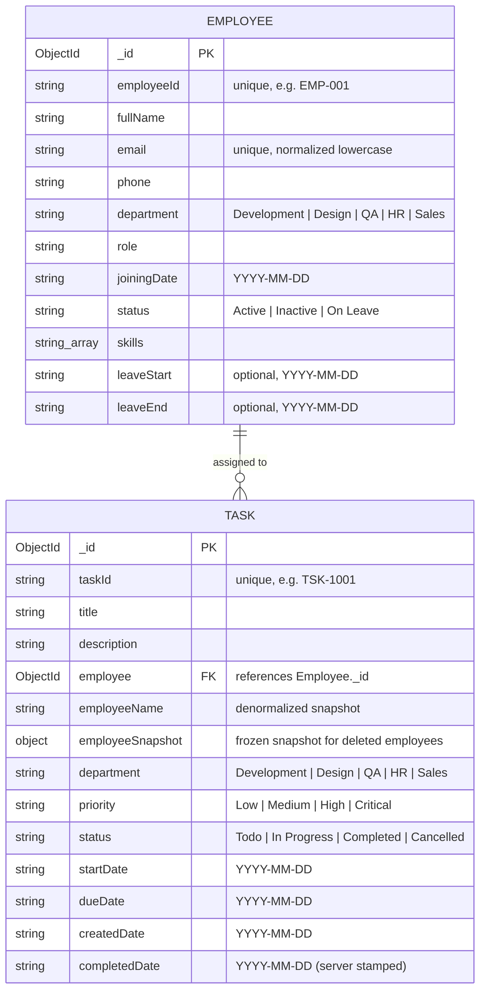

# Employee & Task Management System (ETM)

A robust full-stack MERN application for managing organizational personnel, tracking tasks, monitoring team workload, and enforcing critical business rules at the database and API layer. Built with server-driven pagination, multi-filter search combinations, deterministic sorting, URL synchronization, and responsive design across desktop, laptop, tablet, and mobile.

---

## 📑 Table of Contents
1. [Quick Start & Setup](#-quick-start--setup)
2. [Environment Variables](#-environment-variables)
3. [Database Schemas & Data Model](#-database-schemas--data-model)
4. [How Employee Deletion is Handled](#-how-employee-deletion-is-handled)
5. [API Overview & Status Codes](#-api-overview--status-codes)
6. [Business Rules Enforced on the Backend](#-business-rules-enforced-on-the-backend)
7. [Technical Design Questions & Answers](#-technical-design-questions--answers)
8. [Assumptions](#-assumptions)
9. [Automated Verification Tests](#-automated-verification-tests)

---

## 🚀 Quick Start & Setup

### Prerequisites
- **Node.js**: v18.x or v20.x+
- **MongoDB**: Local MongoDB instance (`mongodb://127.0.0.1:27017/orbit`) or a MongoDB Atlas cluster URI.

### 1. Server Setup
```bash
# Navigate to the server workspace
cd server

# Install dependencies
npm install

# Seed initial dataset (8 employees across departments + 9 realistic tasks)
npm run seed

# Run the 14 automated business rule and pagination tests
npm run test

# Start the Express API server (runs on http://localhost:5000)
npm run dev
```

### 2. Client Setup
```bash
# Navigate to the client workspace
cd ../client

# Install dependencies
npm install

# Run Vite development server (runs on http://localhost:5173)
npm run dev

# (Optional) Verify production build and linting
npm run build
npm run lint
```

---

## 🔑 Environment Variables

The project contains `.env.example` templates in the root directory as well as within `server/` and `client/`.

### Backend (`server/.env`)
| Variable | Required | Default | Description |
| :--- | :---: | :--- | :--- |
| `PORT` | Optional | `5000` | Port on which the Express server listens. |
| `MONGODB_URI` | Required in prod | `mongodb://127.0.0.1:27017/orbit` | MongoDB connection string (Local or MongoDB Atlas cluster). |

### Frontend (`client/.env`)
| Variable | Required | Default | Description |
| :--- | :---: | :--- | :--- |
| `VITE_API_URL` | Optional | `http://localhost:5000/api` | Base API URL queried by Axios client instances. Point to local server or hosted Vercel backend. |

---

## 🗄️ Database Schemas & Data Model

### Entity-Relationship Diagram



### Employee → Task Relationship & Snapshot Pattern
- **Active Reference**: Every task references an `Employee` document via `task.employee` (`ObjectId`).
- **Denormalized Snapshot**: To guarantee historical auditability and prevent broken joins, each task also stores an `employeeSnapshot` object `{ employeeId, fullName, email, role, department }` and an indexed `employeeName` string.
- When an employee updates their profile, active task snapshots synchronize automatically. When an employee is eventually deleted, completed and cancelled tasks retain their frozen snapshot so reports, CSV exports, and audit trails never lose employee attribution.

---

## 🗑️ How Employee Deletion is Handled

1. **Active Task Guard**:
   - Before deleting an employee, the server queries the database for active tasks assigned to that employee (`status IN ["Todo", "In Progress"]`).
   - If any active tasks exist, deletion is **strictly blocked with HTTP 400**:
     ```json
     { "message": "This employee has Todo or In Progress tasks. Reassign or finish them before deletion." }
     ```
2. **Safe Historical Preservation**:
   - When an employee has **0 active tasks** (only `Completed` or `Cancelled` historical tasks), the employee record is safely removed from the `employees` collection.
   - Historical task records keep `task.employee = null` while preserving the full `task.employeeSnapshot` and `task.employeeName`.
   - The UI and CSV export check `task.employee` and fallback to `task.employeeSnapshot`, displaying full details without missing records or crash errors.

---

## 📡 API Overview & Status Codes

### Standard HTTP Status Codes
- `200 OK`: Request succeeded (GET, PUT).
- `201 Created`: Resource successfully created (POST).
- `400 Bad Request`: Validation failure or broken business rule (e.g. invalid status flow, exceeding capacity, due date earlier than start date).
- `404 Not Found`: Requested task or employee does not exist.
- `409 Conflict`: Duplicate unique key violation (Employee ID or Email address already taken).
- `500 Internal Server Error`: Unhandled database error or server exception.

### Endpoint Matrix

#### Employees (`/api/employees`)
| Method | Endpoint | Query / Body Params | Description |
| :--- | :--- | :--- | :--- |
| `GET` | `/api/employees` | `page`, `limit`, `search`, `department`, `status`, `sort`, `direction` | Paginated, searchable, sorted list of employees. |
| `POST` | `/api/employees` | `{ employeeId, fullName, email, phone, department, role, joiningDate, status, skills, leaveStart, leaveEnd }` | Create new employee (validates unique ID and Email). |
| `GET` | `/api/employees/:id` | — | Fetch single employee profile. |
| `PUT` | `/api/employees/:id` | Updated employee fields | Update profile details (syncs snapshot to assigned tasks). |
| `DELETE`| `/api/employees/:id` | — | Delete employee (blocked if active tasks exist). |

#### Tasks (`/api/tasks`)
| Method | Endpoint | Query / Body Params | Description |
| :--- | :--- | :--- | :--- |
| `GET` | `/api/tasks` | `page`, `limit`, `search`, `department`, `priority`, `status`, `dueFrom`, `dueTo`, `sort`, `direction` | Paginated, multi-filtered list of tasks. |
| `POST` | `/api/tasks` | `{ title, description, employeeId, department, priority, startDate, dueDate }` | Create and assign task (enforces capacity, leave, active check). |
| `GET` | `/api/tasks/export` | Same filter params as `GET /api/tasks` | Streams all filtered tasks directly as a CSV file. |
| `GET` | `/api/tasks/:id` | — | Fetch single task with populated employee details. |
| `PUT` | `/api/tasks/:id` | `{ title, description, employeeId, department, priority, startDate, dueDate }` | Update details (rejects direct status modifications). |
| `PUT` | `/api/tasks/:id/status`| `{ status: "In Progress" \| "Completed" \| "Cancelled" }` | Transitions status following strict state machine rules. |
| `DELETE`| `/api/tasks/:id` | — | Delete active task (terminal tasks cannot be deleted). |

#### Dashboard (`/api/dashboard`)
| Method | Endpoint | Description |
| :--- | :--- | :--- |
| `GET` | `/api/dashboard` | Returns server-calculated task counts (`total`, `todo`, `inProgress`, `completed`, `cancelled`, `overdue`), employee counts (`employees`, `activeEmployees`, `inactiveEmployees`, `onLeaveEmployees`), department distribution, and real-time employee workload utilization. |

---

## 🛡️ Business Rules Enforced on the Backend

1. **Task Assignment Eligibility**:
   - Tasks can be assigned only to **Active** employees.
   - Assignment to **Inactive** employees is rejected with `HTTP 400`.
   - Assignment to **On Leave** employees is rejected with `HTTP 400` if `task.startDate` falls between `employee.leaveStart` and `employee.leaveEnd` (inclusive).
   - Assignment to **On Leave** employees is allowed if `task.startDate` falls outside the leave period.
2. **Date Boundaries**:
   - `dueDate` cannot be earlier than `startDate` (`HTTP 400`).
3. **Status Flow State Machine**:
   - Valid forward transitions: `Todo → In Progress → Completed`.
   - Valid cancellation transitions: `Todo → Cancelled` and `In Progress → Cancelled`.
   - All other transitions (e.g. `Todo → Completed` or transitioning from `Completed` / `Cancelled`) are rejected (`HTTP 400`).
   - New tasks start in `Todo`.
   - Task status can only be modified via `PUT /api/tasks/:id/status`; normal task updates (`PUT /api/tasks/:id`) reject status modifications.
4. **Terminal Status Immutability**:
   - `Completed` and `Cancelled` tasks cannot be edited (`HTTP 400`).
   - `Completed` and `Cancelled` tasks cannot be deleted (`HTTP 400`).
5. **Server-Generated Completed Date**:
   - `completedDate` is stamped by the backend at the moment the task transitions to `Completed`. It is never accepted from client payloads.
6. **Capacity Limit**:
   - An employee can hold at most **3 active tasks** (`Todo` + `In Progress`) simultaneously. Assigning a 4th active task is rejected (`HTTP 400`).
7. **Overdue Calculation**:
   - A task is overdue if `today > dueDate` AND `status NOT IN ["Completed", "Cancelled"]`. Reflected across lists, detail views, dashboard, and CSV.

---

## 💡 Technical Design Questions & Answers

### (1) Where do you validate status transitions and why?
- **Where**: Status transitions are validated exclusively on the backend inside `server/src/services/taskService.js` (`updateTaskStatus` method) and isolated behind a dedicated REST endpoint: `PUT /api/tasks/:id/status`. The generic `PUT /api/tasks/:id` endpoint explicitly disallows changing status.
- **Why**: While frontend UI controls (such as dynamic dropdowns) improve user experience by hiding invalid choices, client-side validation can be bypassed using curl, Postman, or script execution. Enforcing the finite state machine (`Todo → In Progress → Completed` and `Todo/In Progress → Cancelled`) on the server guarantees data consistency and prevents invalid jumps (e.g., marking a task completed without starting it).

### (2) Why does Completed Date come from the backend?
- **Why**: Client system clocks can be desynchronized, set to different timezones, or manipulated. Stamping `completedDate` on the server using `new Date().toISOString().slice(0, 10)` at the moment the status transition executes guarantees a reliable, tamper-proof audit trail for turnaround metrics, SLAs, and overdue calculations. Any client-provided `completedDate` in incoming payloads is ignored.

### (3) How do you block inactive / on-leave assignment?
- **How**: Enforced in `taskService.assertCanAssignEmployee` during task creation (`POST /api/tasks`) and task reassignment (`PUT /api/tasks/:id`):
  1. If `employee.status === "Inactive"`, the request immediately aborts with `400 Bad Request`.
  2. If `employee.status === "On Leave"`, the server checks whether `task.startDate` falls between `employee.leaveStart` and `employee.leaveEnd` (inclusive). If inside the leave window, it throws a `400` error specifying the leave period; if outside, the assignment is accepted.

### (4) Why are filtering and pagination handled on the backend?
- **Why**: Handling filtering and pagination in React would require downloading the entire database to the client on every page load. As records scale into thousands or millions:
  1. Client memory and mobile CPU would bottleneck.
  2. Network payload size would degrade responsiveness.
  3. Server-side MongoDB queries utilize indexed B-trees, `$facet` pipelines, `skip()`, and `limit()` to fetch only the required page chunk (e.g., 8 items) in milliseconds, ensuring $O(\log N)$ performance regardless of collection size.

### (5) Why do filters live in the URL?
- **Why**: Persisting filter parameters (`/tasks?status=In%20Progress&priority=High&page=2`) in URL query parameters ensures **stateless shareability and state preservation**:
  - Refreshing the browser preserves the exact filtered view.
  - Users can use browser **Back** and **Forward** buttons to navigate through search history.
  - Team members can copy, bookmark, or email deep links to directly share a specific filtered view with colleagues.

### (6) What can go wrong if two requests assign a 4th active task at the same time?
- **What can go wrong**: A **Time-of-Check to Time-of-Use (TOCTOU) Race Condition**:
  1. Request A queries the database and counts active tasks for Employee X (returns 2).
  2. Concurrently, Request B queries the database and counts active tasks for Employee X (also returns 2).
  3. Both requests observe that `count (2) < limit (3)` and proceed to insert their tasks.
  4. Both tasks are saved, leaving Employee X with **4 active tasks**, violating the 3-task capacity rule.
- **Production Solution**: Prevented by utilizing **MongoDB Multi-Document ACID Transactions** (`session.withTransaction`) with snapshot isolation, an optimistic concurrency version field (`__v`), or an atomic conditional counter on the employee document (`findOneAndUpdate({ _id: empId, activeTasksCount: { $lt: 3 } }, { $inc: { activeTasksCount: 1 } })`).

---

## 📌 Assumptions

1. **Authentication**: In accordance with project requirements, no login or token-based authentication is enforced; the workspace is open for seamless collaboration.
2. **Date Format**: All dates are formatted and validated using ISO-8601 calendar strings (`YYYY-MM-DD`).
3. **Capacity Threshold**: The maximum workload capacity is fixed at 3 active tasks (`Todo` + `In Progress`) per employee. Completed and Cancelled tasks do not count towards capacity.
4. **Pagination Default**: Standard page limit defaults to 8 items per page, with a secondary `_id` tiebreaker sort to guarantee deterministic order.

---

## 🧪 Automated Verification Tests

The backend test suite (`node --test test/businessRules.test.js`) verifies all constraints:

```bash
npm --prefix server run test
```

### Verified Scenarios (14/14 Passing):
- **Rule 1**: Reject duplicate Employee ID with HTTP `409 Conflict`.
- **Rule 2**: Reject duplicate normalized Email with HTTP `409 Conflict`.
- **Rule 3**: Reject assignment to Inactive employee with HTTP `400 Bad Request`.
- **Rule 4**: Reject assignment to On Leave employee when start date is inside leave period (`400`).
- **Rule 5**: Accept assignment to On Leave employee when start date is outside leave period (`201`).
- **Rule 6**: Reject task when `dueDate < startDate` with HTTP `400 Bad Request`.
- **Rule 7**: Reject assignment exceeding 3 active tasks per employee (`400`).
- **Rule 8**: Enforce valid status transition `Todo → In Progress → Completed` and verify server-stamped `completedDate`.
- **Rule 9**: Reject direct status modifications through general update endpoint (`400`).
- **Rule 10**: Block employee deletion when active tasks exist (`400`).
- **Rule 11**: Allow employee deletion when 0 active tasks exist and verify historical task snapshot preservation.
- **Rule 12**: Verify server-calculated dashboard statistics and workload capacity utilization.
- **Rule 13**: Verify CSV export generation with matching filters and overdue flags.
- **Rule 14**: Verify deterministic pagination without duplicate records across pages.

### Verified Scenarios (14/14 Passing):
- **Rule 1**: Reject duplicate Employee ID with HTTP `409 Conflict`.
- **Rule 2**: Reject duplicate normalized Email with HTTP `409 Conflict`.
- **Rule 3**: Reject assignment to Inactive employee with HTTP `400 Bad Request`.
- **Rule 4**: Reject assignment to On Leave employee when start date is inside leave period (`400`).
- **Rule 5**: Accept assignment to On Leave employee when start date is outside leave period (`201`).
- **Rule 6**: Reject task when `dueDate < startDate` with HTTP `400 Bad Request`.
- **Rule 7**: Reject assignment exceeding 3 active tasks per employee (`400`).
- **Rule 8**: Enforce valid status transition `Todo → In Progress → Completed` and verify server-stamped `completedDate`.
- **Rule 9**: Reject direct status modifications through general update endpoint (`400`).
- **Rule 10**: Block employee deletion when active tasks exist (`400`).
- **Rule 11**: Allow employee deletion when 0 active tasks exist and verify historical task snapshot preservation.
- **Rule 12**: Verify server-calculated dashboard statistics and workload capacity utilization.
- **Rule 13**: Verify CSV export generation with matching filters and overdue flags.
- **Rule 14**: Verify deterministic pagination without duplicate records across pages.

